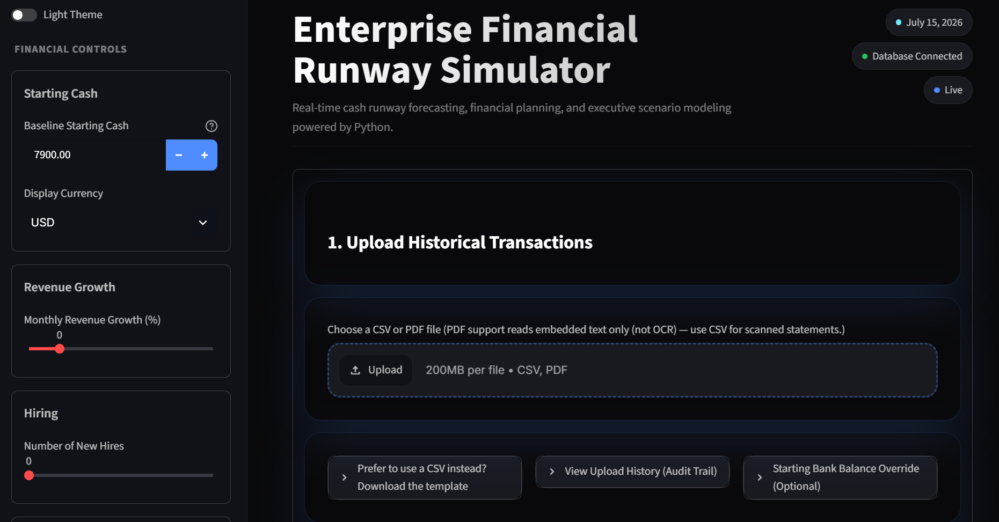
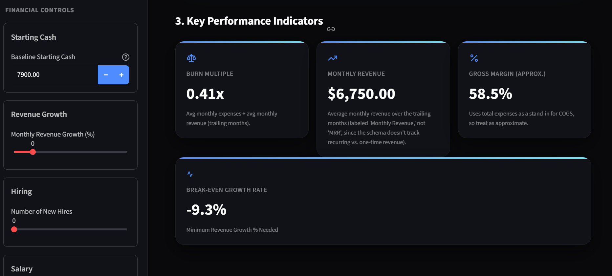
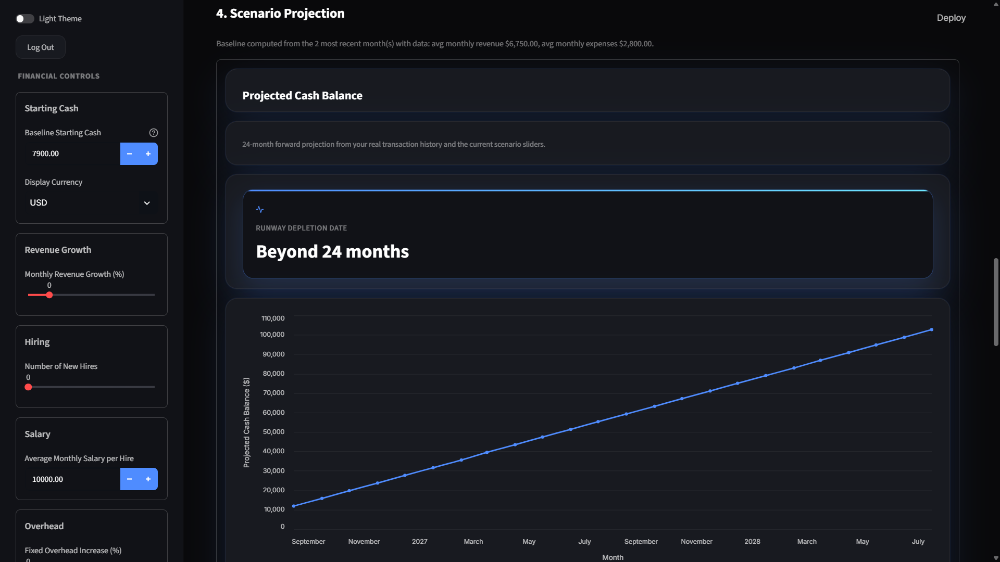
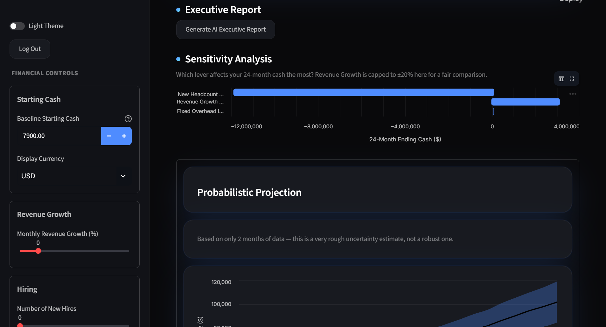
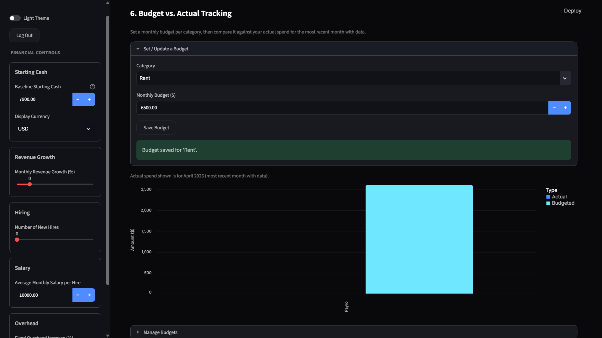

# Enterprise Financial Runway Simulator

**A B2B SaaS financial analytics platform for startup finance teams and founders — real-time cash runway forecasting, scenario modeling, and AI-powered executive reporting, delivered entirely in the browser.**

**🔗 Live demo: [financialrunwaysimulator-agihjfzscdkkddmuwr85bc.streamlit.app](https://financialrunwaysimulator-agihjfzscdkkddmuwr85bc.streamlit.app)** — click **Continue as Guest**, no account required.

## Screenshots

| Dashboard Overview | Key Performance Indicators |
|---|---|
|  |  |

| Scenario Projection | Sensitivity & Probabilistic Analysis |
|---|---|
|  |  |

**Budget vs. Actual Tracking**



## Why this is a B2B SaaS product

**B2B** — this isn't a consumer app. The people who use it care about headcount costs, burn multiples, and runway depletion dates: startup founders, finance teams, and operators who need to answer "how much runway do we have, and what happens if we hire five more engineers?"

**SaaS** — there's nothing to install. It runs entirely in a web browser, built on Streamlit, connected to a live PostgreSQL backend. Open a link, upload your real transaction history, and get instant answers — no desktop software, no spreadsheets to email around.

## Core principle: real data only

Every number in this app comes from data you upload or configure — historical bank transactions, manual overrides, or your own budget targets. Nothing is fabricated, simulated, or hardcoded as a placeholder. If there isn't enough data to compute something reliably (e.g., outlier detection needs 5+ transactions, uncertainty bands need 2+ months of history), the app says so explicitly instead of guessing.

## Features

### Data ingestion
- Upload historical transactions via **CSV or PDF** (PDF reads embedded text from digitally-exported bank statements — not OCR)
- Automatic duplicate protection on re-upload
- Manual starting-balance override for reconciling against a real bank statement
- Full upload audit trail (who, when, what, how many rows inserted/skipped/rejected)

### Analytics & KPIs
- Burn Multiple, Monthly Revenue, Gross Margin, Break-Even Growth Rate
- Spend-by-category and month-over-month revenue/expense trend charts
- IQR-based outlier detection on transaction amounts
- **Budget vs. Actual tracking** — set a monthly budget per category and compare it against real spend

### Scenario modeling
- Interactive sliders for revenue growth, hiring, salary, and overhead — see the impact on a 24-month cash projection instantly
- **Sensitivity analysis** (tornado chart) — which lever moves your runway the most?
- **Monte Carlo probabilistic projection** — a p10/p50/p90 uncertainty band, not just a single-point forecast
- Save and compare named scenarios side by side

### AI & reporting
- On-demand AI Executive Report (Google Gemini) summarizing your current scenario in plain English
- **Export to PDF** (KPI summary) or **Excel** (full transaction history) for offline sharing

### Product polish
- Full light/dark theme toggle
- Live currency conversion display (real FX rates, no fabricated exchange rates)
- Login gate with a **guest access option** — no account required to explore

## Tech stack

| Layer | Technology |
|---|---|
| Frontend / App | Streamlit |
| Data processing | Pandas, NumPy |
| Database | PostgreSQL (SQLAlchemy ORM) |
| Charts | Altair |
| AI | Google Gemini (`google-genai`) |
| PDF parsing | pdfplumber |
| PDF export | fpdf2 |
| Excel export | openpyxl |
| Live FX rates | Frankfurter API (ECB-sourced, free, no key required) |
| Testing | pytest |

## Getting started

### 1. Clone and set up a virtual environment
```bash
git clone https://github.com/abhi-14gyan/Financial_Runway_Simulator.git
cd Financial_Runway_Simulator
python -m venv venv
venv\Scripts\activate        # Windows
pip install -r requirements.txt
```

### 2. Configure environment variables
Copy `.env.example` to `.env` and fill in:
- `DATABASE_URL` — your PostgreSQL connection string
- `GEMINI_API_KEY` / `GEMINI_MODEL` — for the AI Executive Report ([get a key](https://aistudio.google.com/apikey))
- `APP_USERNAME` / `APP_PASSWORD` — demo login credentials (or just use the Guest login on the app itself)

### 3. Initialize the database
```bash
python -m db.init_db
```

### 4. Run the app
```bash
streamlit run app.py
```

Open `http://localhost:8501` — log in, or click **Continue as Guest** to explore immediately with no credentials.

## Project structure
```
app.py                 # Main Streamlit app (UI + page flow)
theme.py                # Custom dark/light theme, reusable UI components
db/                     # SQLAlchemy models, session setup, data access layer
analytics/              # Scenario projection, sensitivity, Monte Carlo, anomaly detection
utils/                  # CSV/PDF parsing, currency FX, PDF/Excel export
tests/                  # pytest suite
```

## Tests
```bash
pytest tests/ -q
```
